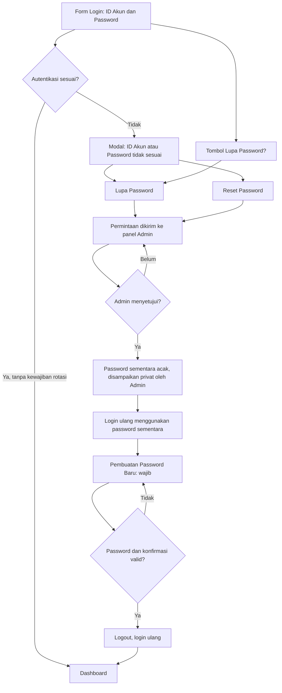

# Samsung Kalteng — Lupa / Reset Password dengan Persetujuan Admin

**Status: DRAFT pengembangan, BELUM dipasang di produksi.**

## Alur pengguna

## Implementasi dalam branch

- `password-recovery.js`: tombol Lupa Password di form login; modal aksesibel saat autentikasi gagal dengan tombol Lupa Password/Reset Password; pengiriman request anonim tanpa mengungkap keberadaan ID; antrean admin pada menu Manpower; approve, tampilkan password sementara satu kali, konfirmasi penyampaian manual.
- `index.html`: memuat modul, menampilkan modal saat kredensial salah, memblokir dashboard ketika `must_change_password`, mencoba route rotasi recovery baru lalu fallback legacy untuk onboarding lama.
- `supabase/functions/password-recovery/index.ts`: draft endpoint anonim `request`, admin-only `list` / `approve` / `mark_delivered`, self-only `rotate`. Menggunakan JWT untuk otorisasi aksi admin dan penggantian password. Password 28 karakter acak dari CSPRNG; tidak disimpan ke database/log. Admin menyampaikan password secara privat, **bukan mengirim WhatsApp otomatis**.
- `docs/sql/20261110-password-recovery-approval-draft.sql`: draft antrean reset dengan RLS deny-by-default dan tanpa kolom password.
- `tests/password-recovery-smoke.cjs`: pemeriksaan kode statis tanpa koneksi atau mutasi database.

## Keamanan dan masa aktif

- Password sementara dimaksud berlaku selama **24 jam** untuk proses rotasi. Supabase Auth *tidak memiliki waktu kedaluwarsa per password*. Endpoint rotasi memeriksa `expires_at`, namun **bypass ke endpoint aktivasi lama harus ditutup sebelum deploy**.
- Selama recovery, profil pengguna `is_active=false`, `must_change_password=true`; frontend mengunci dashboard. **Wajib audit seluruh RLS dan RPC** agar token lama maupun token baru tidak dapat mengambil data bisnis sampai selesai.
- Pengajuan anonim merespons pesan generik. Draft memberi batas per akun/IP, tetapi **belum memadai terhadap distributed abuse, concurrent submissions, IP spoofing dan enumeration berbasis timing**. Sebelum production, aktifkan CAPTCHA/Turnstile yang diverifikasi server, trusted proxy IP, dan rate limiting atomik pada database/edge gateway.
- **Recovery gagal** pada fase status update/penyampaian rahasia dapat meninggalkan akun terkunci. Tambahkan tindakan admin reissue untuk status failed/expired dan konfirmasi hasil setelah pengujian failover.
- Audit user, actor, outcome, timestamp, delivery acknowledgement tanpa merekam password/credential. Tetapkan retention policy dan cleanup berjadwal.
- **Jangan tampilkan password sementara di grup/Markdown dokumen publik.** Hanya kanal privat setelah verifikasi identitas. Admin bertanggung jawab untuk distribusi.
- Proteksi akun Admin menggunakan prosedur pemulihan terpisah; permintaan publik pada endpoint ini dibatasi EC/TL/TSO, bukan Admin.
- Tidak ada proses reset pada akun sebenarnya sebelum persetujuan produksi lanjutan.

## Release gates — semua harus lulus sebelum merge/deploy

1. Migrasi diterapkan hanya pada staging yang terisolasi; anon/authenticated tidak dapat SELECT/INSERT/UPDATE tabel permintaan.
2. Uji anonymous enumeration, spam 429/generic status, flood IP, race dan CAPTCHA; tidak ada akun fiktif yang bocor.
3. Uji pengguna aktif TL dan EC; notifikasi Admin; approve hanya oleh admin aktif, bukan role lain.
4. Verifikasi password berbeda pada 2 reset, hanya tampil satu kali, tidak tersimpan browser/SQL/log.
5. Verifikasi rotasi TL dan EC; masa berlaku 24 jam; permintaan baru setelah kedaluwarsa; reissue aman tanpa lockout permanen.
6. Uji pending recovery `is_active=false` terhadap seluruh RLS/RPC dan session tokens, termasuk memanggil REST langsung.
7. Uji pemulihan saat salah satu dari update profil, update Auth, update permintaan, konfirmasi pengiriman gagal.
8. Validasi akses dashboard saat sudah selesai dan setelah login ulang; beri pesan jika tidak ada request approved.
9. Uji keyboard focus, Escape, aria-live modal, mobile UI, dan kondisi koneksi terputus.
10. Review backup dan rollback, lalu **minta persetujuan eksplisit** untuk perubahan DB, Edge Function, dan rilis frontend produksi.

**Catatan:** pengujian statis saja bukan bukti sistem backend aman atau siap production.
